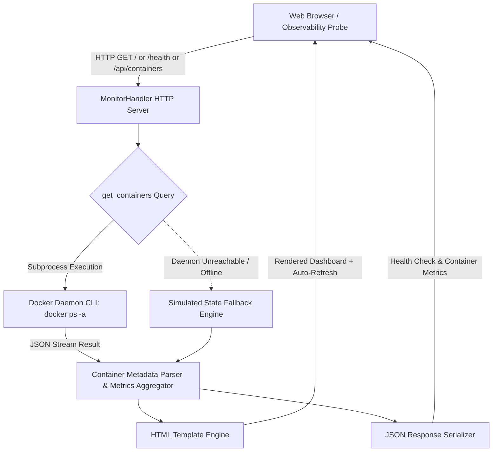
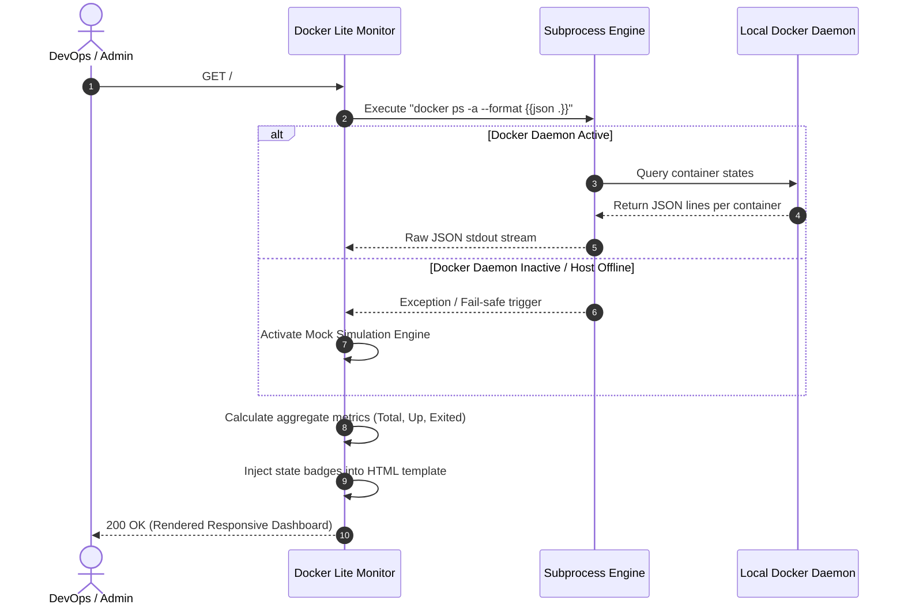

# 🐳 docker-lite-monitor

> **Topics:** `docker` `container-monitoring` `docker-api` `devops` `dashboard` `lightweight-monitoring` `single-file`


[](https://github.com/MobileConduit/docker-lite-monitor/releases/tag/v1.0.0)
[](https://github.com/MobileConduit/docker-lite-monitor/actions)
[](LICENSE)
[](https://python.org)
[](https://github.com/MobileConduit)

A self-contained, high-performance Docker supervisor dashboard that queries container states directly via the local Docker daemon CLI and provides an ultra-fast HTML view, automated health check endpoint, and JSON API without bulky third-party agents or heavy runtime stacks.

---

## 🏗️ Architecture



## 🔄 Request Sequence Flow



---

## ✨ Features

- **Zero Runtime Dependencies**: Runs natively using Python's standard library (`http.server`, `subprocess`, `json`, `argparse`).
- **Live & Mock-Safe**: Automatically reads live container state via the Docker daemon, with seamless fail-safe mock fallback for offline or testing environments.
- **REST & Health Endpoints**: Built-in `/health` (or `/healthz`) and `/api/containers` endpoints for integration with monitoring systems (Prometheus, Nagios, Kubernetes probes).
- **Modern Responsive Dashboard**: Dark-mode glassmorphic interface with metric cards, status badges, and configurable auto-refresh rates.
- **Configurable**: Fully manageable via command-line arguments and `.env` environment variables.

---

## 🚀 Quick Start

### 1. Run Directly

```bash
# Clone the repository
git clone https://github.com/MobileConduit/docker-lite-monitor.git
cd docker-lite-monitor

# Run with defaults (Port 9090)
python monitor.py

# Open your browser at http://localhost:9090
```

### 2. Custom Port & Mock Mode

```bash
# Run on port 8080 with mock data enabled and 5s auto-refresh
python monitor.py --port 8080 --mock --refresh 5
```

---

## ⚙️ Configuration & Environment Variables

Copy `.env.example` to `.env` to customize settings:

| Option | Env Variable | Default | Description |
|---|---|---|---|
| `--host` | `MONITOR_HOST` | `0.0.0.0` | Host IP address to bind to |
| `--port` | `MONITOR_PORT` | `9090` | HTTP port to expose |
| `--mock` | `MONITOR_MOCK_FALLBACK` | `false` | Force simulated containers |
| `--refresh` | `MONITOR_REFRESH_RATE` | `10` | Web dashboard auto-refresh interval (s) |

---

## 📡 API Endpoints

- `GET /` or `GET /dashboard`: Responsive web supervision dashboard.
- `GET /health` or `GET /healthz`: Health check endpoint returning status and aggregated container metrics.
  ```json
  {
    "status": "UP",
    "service": "docker-lite-monitor",
    "version": "1.1.0",
    "mode": "live",
    "containers": {
      "total": 4,
      "running": 3,
      "stopped": 1
    },
    "author": "Eng. MHD. Shadi AL-Hasan"
  }
  ```
- `GET /api/containers`: Complete array of container status objects formatted in JSON.

---

## 🧪 Automated Testing

Run the automated Pytest test suite:

```bash
pytest --verbose tests/
```

---

---

## ⚙️ Installation & Setup

```bash
git clone https://github.com/MobileConduit/docker-lite-monitor.git
cd docker-lite-monitor
pip install -r requirements.txt
```

## 👤 Author & Maintainer

**Eng. MHD. Shadi AL-Hasan**  
- **Role:** Executive CTO & Enterprise Solutions Architect  
- **Email:** [mhd.shadi.alhasan@gmail.com](mailto:mhd.shadi.alhasan@gmail.com)  
- **Phone / WhatsApp:** [+963934005922](tel:+963934005922)  
- **Location:** Damascus, Syria  
- **GitHub:** [MobileConduit](https://github.com/MobileConduit)  

---

## 📄 License

This project is licensed under the MIT License - see the [LICENSE](LICENSE) file for details.  
Copyright (c) 2026 **MHD. Shadi AL-Hasan**. All rights reserved.